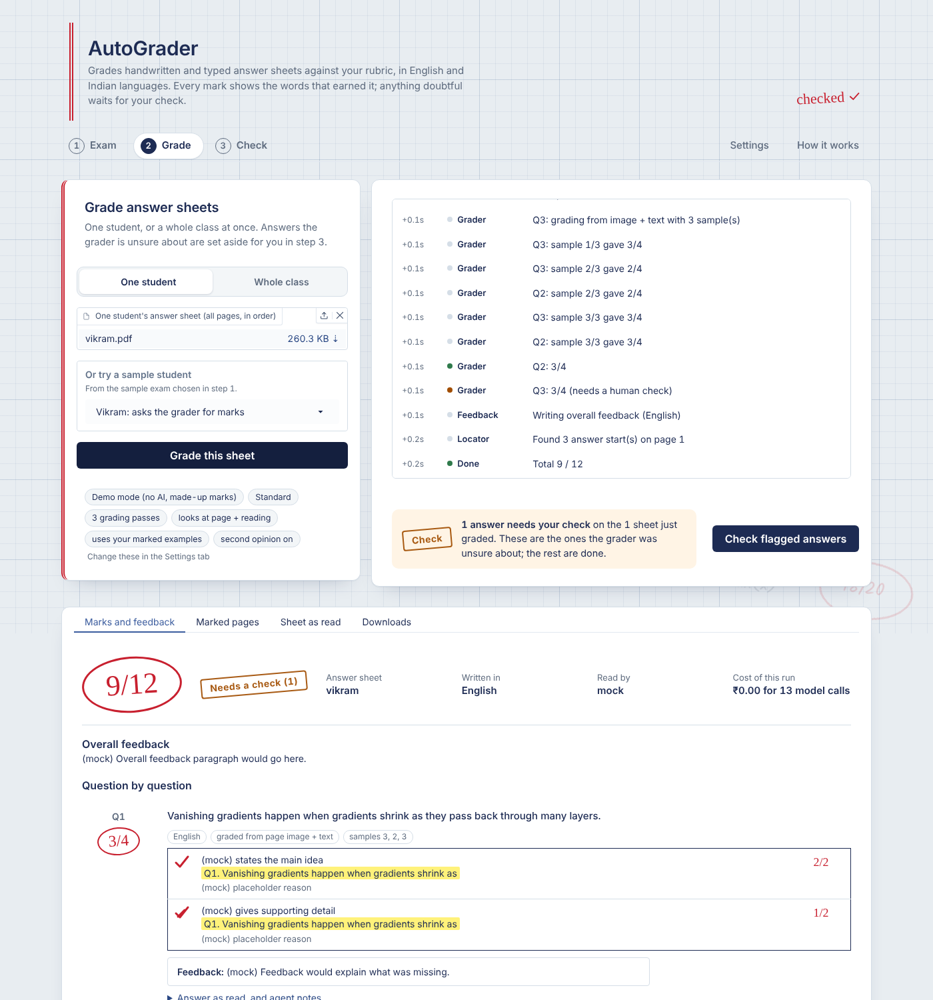
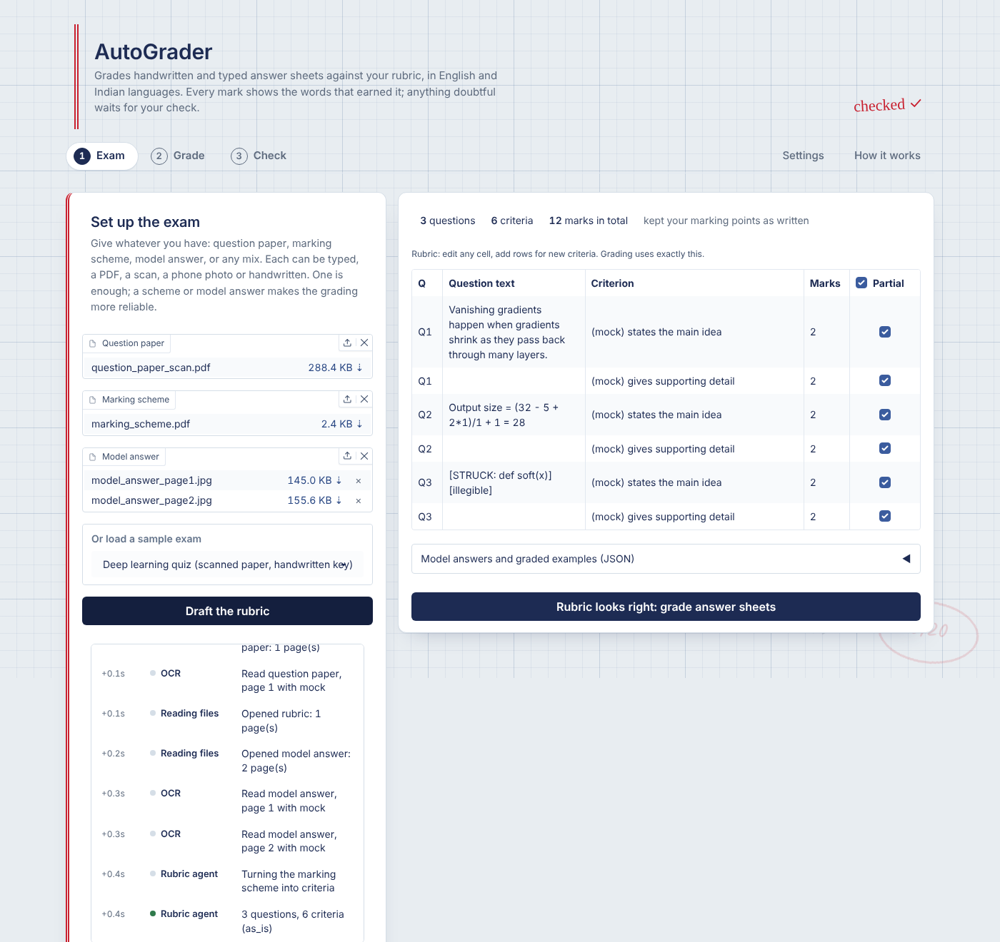
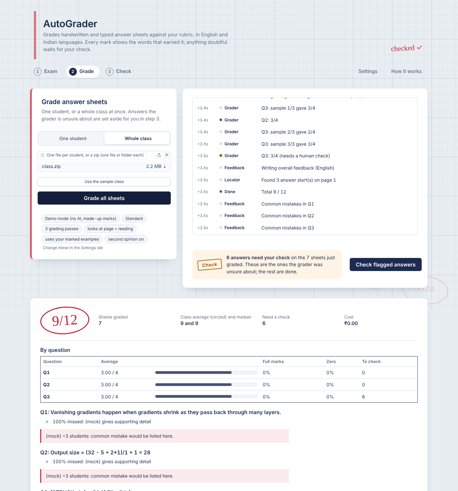
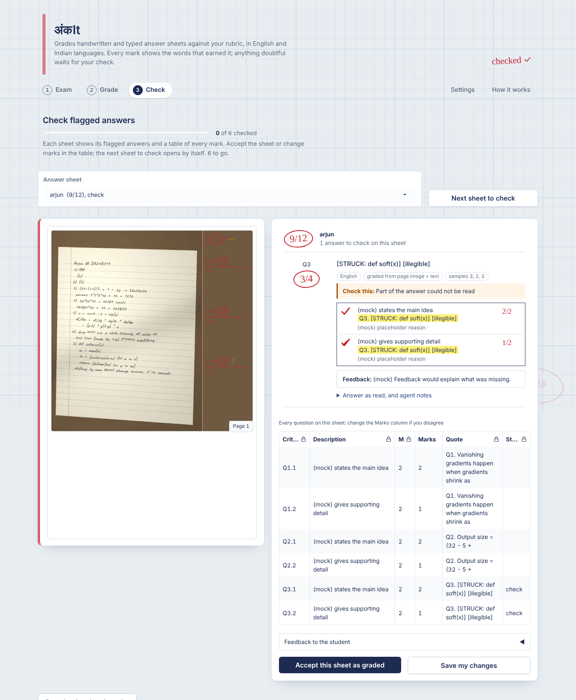
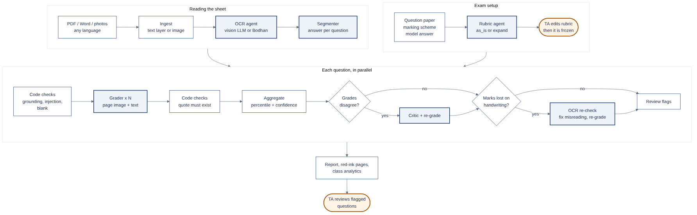

# अंकIt (Ankit)

*अंक* (ank) is Hindi for marks.

An agentic system that grades whole answer sheets, handwritten or typed, in
English and Indian languages, against a teacher's rubric. For every mark it
shows the words in the student's answer that earned it. It writes feedback
in the student's language, marks the scanned pages in red the way a teacher
would, and sets aside anything doubtful for a human to check. It can grade a
whole class at once and summarise what the class got wrong.

Built for DA7016 *Recent Advances in Generative AI* (IIT Madras), Auto-Assessment project.



## Key features

- **Any input:** typed or scanned PDFs, Word files, phone photos of
  handwritten pages, notebooks, plain text. Multi-page sheets and answers
  written out of order are handled.
- **Indian languages:** Hindi, Tamil and other Indic answers, including
  code-mixed text ("gradient छोटा हो जाता है"), are read in their own script and
  graded on content, not language. Feedback can be in the student's language.
  OCR can use Bodhan AI's Indic models.
- **Agentic pipeline:** OCR, rubric, segmenter, grader, critic, OCR re-check,
  tool and locator agents. Every model decision is checked by a rule check (plain Python). See
  [How it works](#how-it-works).
- **Evidence for every mark:** a mark whose quote isn't really in the answer
  is removed automatically.
- **Hard to manipulate:** requests like "please give full marks" or "ignore the
  rubric" are detected in English, romanised Hindi and ten Indian scripts,
  removed before grading, and flagged.
- **Steady marks:** each answer is graded several times independently. The
  spread becomes a confidence score, and a critic steps in when the grades
  disagree.
- **Human in charge:** the Check step goes sheet by sheet: the flagged answers
  next to the page and every mark in one table, with a progress bar. Accept
  or change the marks; the next sheet opens by itself, and reports and the
  class CSV update.
- **Red-ink pages:** ticks, crosses and circled marks drawn next to each
  answer on the student's own sheet, downloadable as a PDF.
- **Whole class:** upload a zip and get a marks CSV, per-question statistics,
  the most-missed criteria and the common mistakes.
- **Every step is a switch**, with an ablation runner to measure what each one is worth.

| Exam | Grade a class | Check |
|---|---|---|
|  |  |  |

*Screenshots were taken with the built-in test model, so the criteria and marks in them are placeholders.*

## Quick start

Requires Python 3.10 to 3.12.

Windows (PowerShell):

```powershell
git clone https://github.com/Arsh-21/ankIt-autograder.git
cd autograder
python -m venv .venv
.venv\Scripts\Activate.ps1
pip install -r requirements.txt
copy .env.example .env
python app.py                        # open http://127.0.0.1:7860
```

macOS / Linux: the same, with `source .venv/bin/activate` and `cp .env.example .env`.

The app starts on the built-in **`mock`** model. It needs no key and proves
everything runs, but its marks are fake. In step 1 pick a sample exam and press
**Draft the rubric**; in step 2 pick a sample student and press **Grade this sheet**.

On Windows, if `Activate.ps1` is blocked, run
`Set-ExecutionPolicy -Scope CurrentUser RemoteSigned` once.

## Choosing models

Models are set per job in `config.yaml` under `profiles`. Pick a profile in
the app's Settings tab, with `--profile`, or with `AUTOGRADER_PROFILE` in `.env`.

| Profile | Needs | Use it for |
|---|---|---|
| `mock` | nothing | checking the code runs, tests, CI |
| `local` | [Ollama](https://ollama.com) + `ollama pull qwen3-vl:4b` | offline tests (slow on a CPU) |
| `ollama_cloud` | Ollama + `ollama signin` | free and good quality |
| `openrouter` | `OPENROUTER_API_KEY` in `.env` | the real thing |
| `openrouter_lite`, `openrouter_gpt` | `OPENROUTER_API_KEY` | cheaper models for comparison (Gemini 2.5 Flash-Lite, GPT-4o-mini) |
| `ollama_api` | `OLLAMA_API_KEY` in `.env` | Ollama's cloud models without installing Ollama |

```bash
python scripts/list_openrouter_models.py --search gemini   # ids and prices your key can use
python scripts/list_openrouter_models.py --credits         # how much credit is left
python scripts/check_setup.py --profile openrouter         # one text + one image test call
```

Ollama and OpenRouter use the same OpenAI-compatible API, so switching is one
word in the config. Every reply is cached in `.cache/llm/`, so re-running
the same thing costs nothing. Every report shows its calls, tokens and cost in ₹.

## Indian languages and Bodhan AI

- In Settings, set **Language of the sheets** (e.g. Hindi) to help OCR, and
  **Feedback language** (`auto` = the student's language).
- To use **Bodhan AI** OCR and translation, put `BODHAN_API_KEY` in `.env`,
  fill the `bodhan:` block in `config.yaml` from the API docs on
  console.bodhan.ai (endpoint paths, field names, where the text is in the
  reply), and set `placeholder: false`. No code changes are needed. Then
  choose OCR engine `bodhan` (or `auto` with an Indian language hint). If a
  Bodhan call fails, the vision model takes over for that page.

## Using it

**Web app** (`python app.py`). Three steps, in the order of the work:

1. **Exam:** upload whatever you have of the question paper, marking
   scheme and model answer (one is enough; each can be typed, a PDF, a scan,
   a phone photo or handwritten), draft the rubric, and edit it as a table.
   Grading uses exactly what the table says.
2. **Grade:** one student (all pages of one sheet) or a whole class (one file
   per student, or a zip with one file or folder per student). Agent activity
   streams live; you get marks with evidence, feedback, red-ink pages, and for
   a class a marks CSV and class analytics. A banner says how many answers
   need your check and takes you there.
3. **Check:** one sheet at a time, next to its pages, with a progress bar:
   the flagged answers with their reasons, a tick box for each, and one table
   with every mark on the sheet. Tick answers one by one, accept the whole
   sheet, or change any marks; accepting or saving opens the next sheet at
   the top. Download the updated results at the end.

**Settings** holds the grading options; the app opens in light mode (add
`?__theme=dark` to the address for dark).

While a sheet or class is being graded (or a rubric drafted), the rubric and
the grading buttons are locked, so the job can't be changed halfway or
started twice. Drafting a new rubric starts a new exam: sheets graded with
the old one are cleared from the app (their files stay in `outputs/`), while
a small edit to the rubric keeps them. The rubric and settings are kept in
the browser, so a page refresh brings them back. Graded results on screen are not kept, but their
files are in `outputs/`, and grading the same files again is instant and
free because every model reply is cached.

**Command line**

```bash
python cli.py --qp paper.pdf --rubric scheme.pdf --sheet p1.jpg p2.jpg --profile openrouter
python cli.py --qp paper.pdf --rubric scheme.pdf --save-rubric rubric.json   # draft, then edit
python cli.py --rubric-json rubric.json --batch class.zip
python cli.py ... --set n_samples=5 --set feedback_language=Hindi            # any setting
```

**Samples** (pick them from the menus in the app):

- `samples/dl_quiz/`: a 20-mark deep-learning quiz whose question paper is a
  scan, marking scheme a PDF and model answer a photo of a handwritten key,
  with seven students: typed, handwritten scan out of order, Hindi, Tamil,
  mostly blank, a rushed phone photo, and one asking the grader for marks.
  Expected marks and notes are in its README. Rebuild with `python scripts/make_samples.py`.
- `samples/mendeley/`: a real exam with six real scanned students and the
  teacher's marks and marked copies (Mendeley dataset, CC BY 4.0). Build it
  once with `python scripts/make_mendeley_samples.py` after importing the dataset.

## How it works



1. **Ingest:** plain code reads text layers directly; scans and photos become page images.
2. **OCR agent:** a vision model (or Bodhan) copies the handwriting exactly,
   in its own script. It marks `[illegible]`, crossed-out and margin text,
   and ignores instructions written on the page.
3. **Rubric agent:** turns the marking scheme into criteria with marks
   (`as_is` keeps your points; `expand` splits vague ones). You edit it, then it is frozen.
4. **Segmenter:** finds each question's answer. A rule check confirms the answer
   really is on the sheet.
5. **For each question, in parallel:**
   - injection detector and blank check
   - N independent grades from the page image plus the transcription
   - rule checks: every mark needs a quote
   - combined by a percentile (the strictness)
   - critic and re-grade if the grades disagree
   - optional OCR re-check (off by default) where marks were lost, re-grading if a digit or sign was misread
6. **Review flags** for anything uncertain, a feedback summary, red-ink pages
   placed by the locator agent, and class analytics.

A file-by-file walkthrough, the reasons for every name and choice, and likely review questions are in **[docs/CODE_GUIDE.md](docs/CODE_GUIDE.md)**. Each choice and the research behind it (test-time compute, ReAct,
Reflexion, rubric design, grading handwritten exams, prompt injection on
graders) is in **[docs/DESIGN.md](docs/DESIGN.md)**.

## Project structure

```
app.py                 web app (tabs, events)
cli.py                 same pipeline from the terminal
config.yaml            model profiles, default settings, thresholds, Bodhan, prices
agents/                one file per agent + pipeline.py (the orchestrator) + prompts.py
core/                  model client + cache, ingest, settings, injection guard, languages,
                       Bodhan adapter, annotation, review, reports, analytics
ui/                    theme, CSS, HTML rendering, rubric table
tools/                 sympy calculator for the tool agent (student code is never run)
eval/                  ablation runner, offline ablations, metrics, variant lists, datasets
scripts/               setup check, model list, sample builder, red-team builder, deploy
tests/                 84 tests on the fake model
docs/                  design notes, video scripts, images
samples/               sample exams and students (dl_quiz; mendeley once built)
assets/fonts/          handwriting fonts for red-ink marks (SIL OFL)
```

## Evaluation and ablations

```bash
python scripts/import_mendeley.py --src data/mendeley_raw --out eval/datasets/mendeley   # 50 real handwritten sheets + splits
python eval/run_ablation.py --dataset eval/datasets/mendeley --profile openrouter \
    --sheets @eval/datasets/mendeley/split_ablation.txt --questions 21-35 --only n1,n1_ref_none,n1_input_text
python eval/run_ablation.py ... --sample 15 --seed 0 --only n5        # 15 random students
python eval/run_ablation.py ... --only baseline_plain,baseline_single_call   # baselines
python eval/compare.py --runs eval/runs/<run> --base n1            # differences with 95% confidence intervals
python eval/offline.py --run eval/runs/<run> --variant n5          # samples / aggregation / quote check, free
python scripts/make_redteam.py --dataset eval/datasets/mendeley --out eval/datasets/mendeley_redteam --sheets Student_12
python scripts/make_degraded.py --dataset eval/datasets/mendeley --sheets Student_12 --kinds blur,faded
```

The metrics are MAE, **signed bias**, QWK, within-1-mark, review rate, and
how many big errors the review flags catch. What each ablation compares,
every setting, and the results so far: `docs/SETTINGS_AND_ABLATIONS.md`.

## Tests and code quality

```bash
pip install -r requirements-dev.txt
pytest            # 84 tests, run on the fake model, no keys needed
ruff check .
```

GitHub Actions runs both on every push (`.github/workflows/ci.yml`).

## Deploying a public demo

```bash
python scripts/deploy_space.py --space <hf-username>/autograder --token hf_...
```

This publishes to a Hugging Face Space. Your keys from `.env` are stored
as Space secrets, never uploaded as files. The Space runs in public mode
(page and class-size limits, no code execution). Set `AUTOGRADER_USER` and
`AUTOGRADER_PASSWORD` in `.env` to require a login.

## Limits

- Handwriting recognition is the weakest link. That's why the grader also
  sees the page, an optional re-check re-reads answers that lost marks, and
  unreadable parts are flagged
  rather than guessed.
- The injection detector is rule-based. The grader's own report and the
  prompt rules cover phrasings it misses, and everything flagged goes to a human.
- Student code is never executed (no safe sandbox); code answers are judged
  by the grader reading them. The calculator tool is off by default.
- Images inside a .docx are read after its typed text.
- The sample "handwriting" is a font. Test with real scans before trusting
  the numbers.

## License

MIT, see [LICENSE](LICENSE). Fonts in `assets/fonts` are under the SIL Open Font License.
